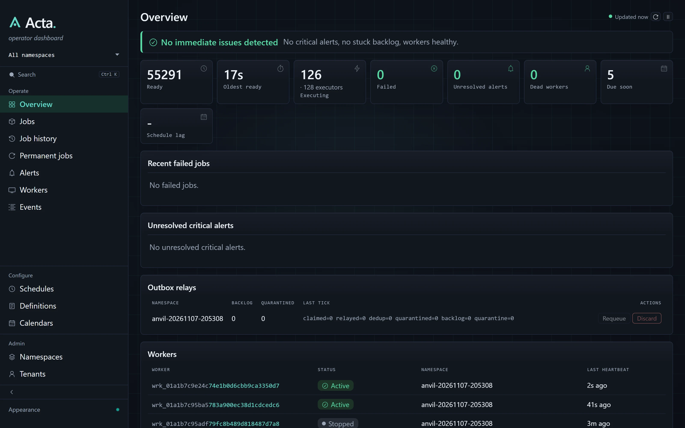

# Acta

**Durable jobs and workflows for .NET.** Everything is a job, and every job is a row.

[](https://github.com/acta-dotnet/acta/actions/workflows/ci.yml)
[](https://www.nuget.org/packages/Acta)
[](./LICENSE)
[](https://useacta.net/)

> **1.0.0-rc.8.** A release candidate: the public API, the schema, and the persisted codes freeze at 1.0.0, and until then a new candidate may still change them. This one re-cuts the schema, so a database an earlier candidate provisioned is dropped and reprovisioned ([release notes](./docs/release-notes.md)). Bring a real workload; the evidence behind each tag is in the repository.

Acta is for background work that has to survive a crash and be explained afterwards. Jobs, retries, schedules, durable steps, long waits, child jobs, and operator controls are rows in the PostgreSQL, SQL Server, or SQLite database your application already uses, with no broker, sidecar, or separate server to run. Execution is at-least-once: a handler can run again, so its external effects are made idempotent.

## Run a job

From an empty folder, with the [.NET 10 SDK](https://dotnet.microsoft.com/download/dotnet/10.0) and nothing else. It runs on embedded SQLite.

```bash
dotnet new web -n Shipping && cd Shipping
dotnet add package Acta.Sqlite --prerelease
dotnet add package Acta.Dashboard --prerelease
```

Replace `Program.cs` with this, all of it:

```csharp
using Shipping;                 // the generated manifest lands in your project's root namespace
using Acta;
using Acta.Dashboard;
using Acta.Sqlite;

var builder = WebApplication.CreateBuilder(args);

builder.Services.UseActa(j =>
{
    j.UseSqlite(sqlite =>
    {
        sqlite.ConnectionString = "Data Source=acta-local.db";
        sqlite.MigrateOnStartup = true;   // local development only; in production a deploy step runs "jobs migrate"
    });
    j.Run<ShippingJobs>("shipping");
});

var app = builder.Build();
app.MapActa("/acta");           // dashboard + JSON API; local-only by default, controls disabled

// Your own endpoint enqueues: the job is a durable row before the response goes out.
app.MapPost("/orders/{orderId:int}", async (int orderId, IJobs jobs) =>
{
    var job = await jobs.EnqueueAsync(new ShipOrder(orderId));
    return Results.Accepted("/acta", new { job.JobRef });
});

app.Run();

public sealed record ShipOrder(int OrderId);

public static class ShippingHandlers
{
    [Job("ship-order")]
    public static void Handle(ShipOrder input) => Console.WriteLine($"Shipping order {input.OrderId}");
}
```

```bash
dotnet run
# then, in a second terminal, on the port dotnet run printed:
curl -X POST http://localhost:5090/orders/1042
# the app prints: Shipping order 1042
```

The endpoint answers `202 Accepted` with the job's ref once the row is stored, and a worker in the same process runs it. Swap `UseSqlite` for `UsePostgres` or `UseSqlServer` and nothing else changes.

## The row it leaves

The job was a row in `acta-local.db` before the handler ran, and it is still one afterwards:

```sql
SELECT job_ref, definition_name, job_status, execution_number, failure_count
FROM   jobs_view
WHERE  namespace_name = 'shipping'
ORDER  BY created_at_utc DESC;
```

```text
job_ref                               definition_name  job_status  execution_number  failure_count
01a1b2dc-c57a-7f0e-9e94-d65c1a009f58  ship-order       succeeded   1                 0
01a1b2dc-c4c4-7c88-8c55-0683945415fc  sys.retention    idle        0                 0
01a1b2dc-c4c3-7ba6-9225-fd934de999c0  sys.alerts       idle        0                 0
```

The other two rows are Acta's own retention and alert jobs, which run the same way yours do. Stop the app and start it again: the rows are there, and so is every event of each job in `events_view`.

The dashboard at `/acta` on the same port reads the same tables. Here it is on a larger system, mid-run:



## Where to go next

- [Your first job, end to end](./docs/first-job.md): a typed result, a failure that is final and one that retries, cancel, a wait with a timeout, and the first test.
- [Choosing Acta](./docs/choosing-acta.md): when Acta fits, when the tool you have is the better choice, and how to move from another scheduler.
- [Developer guide](./docs/developer-guide.md): steps, signals, child jobs, schedules, lanes, limits, and testing.
- [Operator guide](./docs/operator-guide.md): deploying with `jobs migrate` and `jobs deploy`, the dashboard and the CLI, alerts, and what happens when something fails.
- [HTTP contract](./docs/reference/openapi.json): `Acta.AspNetCore` serves a JSON API described by this OpenAPI document, and standard OpenAPI tools generate a client from it.
- [Engineering Labs](./docs/engineering-labs.md): each behavior as a runnable project in [`concepts/`](./concepts/), with the rows that show it.
- [Known limitations](./docs/known-limitations.md) and [compatibility and support](./docs/compatibility-and-support.md): what Acta does not do, the supported databases and packages, and the evidence behind each release.
- [Every page, by the question it answers](./docs/README.md), and the site at [useacta.net](https://useacta.net/).

## How this was built

The inner core is the author's. The data model, the execution semantics, the claim and lease machinery, and every public API signature are deliberate human decisions, defensible column by column and method by method. AI was used heavily, and deliberately, on the outer core: test scaffolding, documentation, consistency sweeps, benchmark tooling. Every line passed the same gates either way: the test suites on three databases, a conformance contract, drift-checked generated docs, recorded benchmark baselines. AI made the work faster. It did not make the decisions.

## License

Apache-2.0. The runtime, dashboard, CLI, and official SQL providers are free. See [`LICENSE`](./LICENSE).
